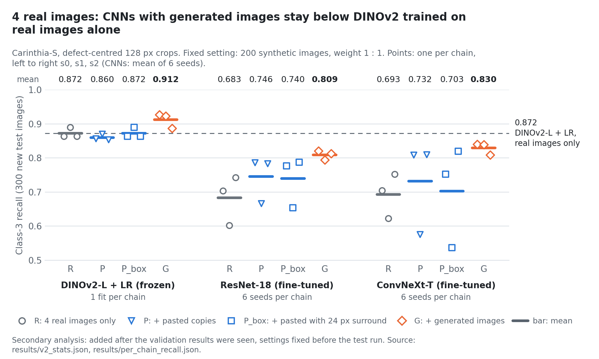
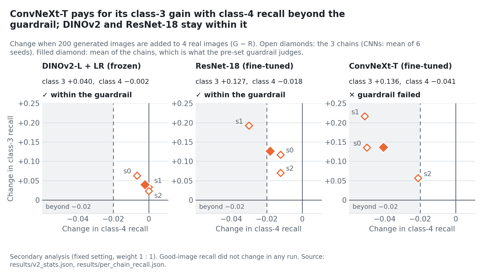
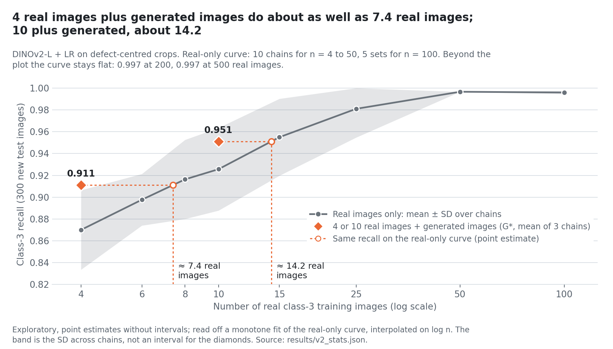
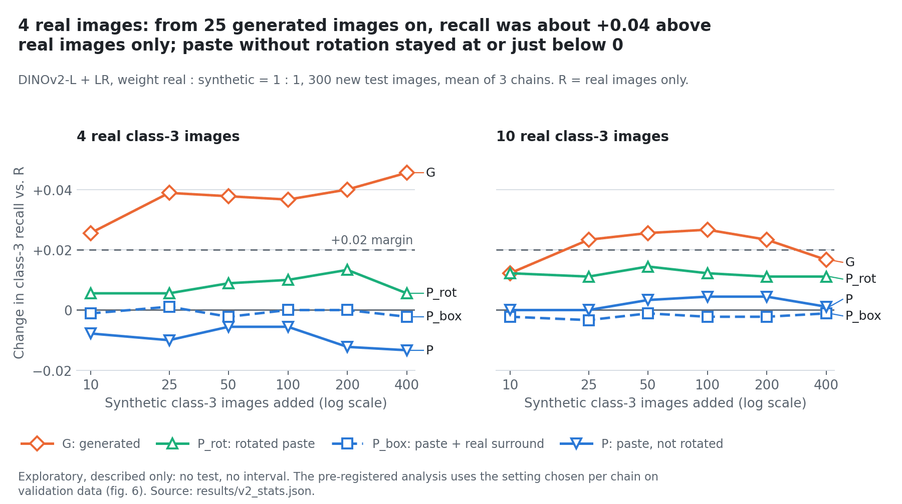
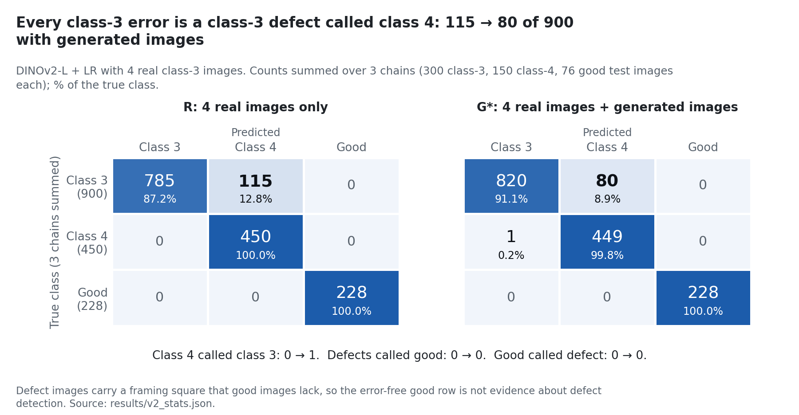
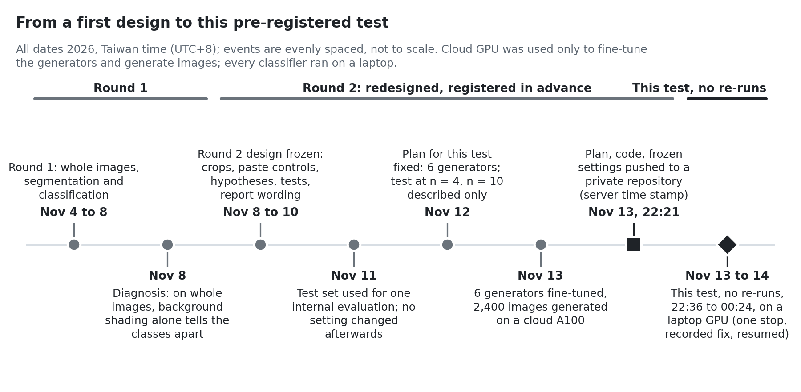

# Details: secondary and exploratory analyses, disclosures, compute, evidence

This page continues [README.md](README.md). Terms, design, hypotheses, verdict rules and the primary results are on the main page. Numbers in square brackets refer to the reference list at the end of README.md.

## Secondary analysis

The following analysis (DINOv2-L [3], ResNet-18 [7], ConvNeXt-T [8]) was added only after the validation results had been seen, with its setting fixed before the test (200 images, 1 : 1, 6 CNN seeds); the intervals are bootstrap intervals over 3 chains and under-cover (their actual coverage is below 95%).

<picture>
  <source media="(prefers-color-scheme: dark)" srcset="figures/fig07_classifiers_dark.png">
  
</picture>

Figure 7. Class-3 recall at n = 4 with the fixed setting (200 synthetic images, real : synthetic = 1 : 1). Each point is one chain (left to right s0, s1, s2; CNNs: mean of 6 seeds), bars are the means of the 3 chains, and the dashed line is the 0.872 of DINOv2-L + logistic regression on real images only. The y axis starts at 0.5 because the lowest single-chain CNN value is 0.537.

**Main table (n = 4, fixed setting; mean over chains and seeds)**

| Classifier | Training set | Class 3 | Class 4 | Good | Balanced accuracy | Runs |
|---|---|---|---|---|---|---|
| DINOv2-L + LR | R | 0.872 | 1.000 | 1.000 | 0.957 | 3 |
| DINOv2-L + LR | P | 0.860 | 1.000 | 1.000 | 0.953 | 3 |
| DINOv2-L + LR | P_box | 0.872 | 1.000 | 1.000 | 0.957 | 3 |
| DINOv2-L + LR | G | 0.912 | 0.998 | 1.000 | 0.970 | 3 |
| ResNet-18 | R | 0.683 | 0.986 | 1.000 | 0.890 | 18 |
| ResNet-18 | P | 0.746 | 0.981 | 1.000 | 0.909 | 18 |
| ResNet-18 | P_box | 0.740 | 0.984 | 1.000 | 0.908 | 18 |
| ResNet-18 | G | 0.809 | 0.968 | 1.000 | 0.926 | 18 |
| ConvNeXt-T | R | 0.693 | 0.983 | 1.000 | 0.892 | 18 |
| ConvNeXt-T | P | 0.732 | 0.969 | 1.000 | 0.900 | 18 |
| ConvNeXt-T | P_box | 0.703 | 0.975 | 1.000 | 0.893 | 18 |
| ConvNeXt-T | G | 0.830 | 0.943 | 1.000 | 0.924 | 18 |

The pre-registered primary analysis (H1, DINOv2, settings chosen on validation data): supported at n = 4 (+0.039, [+0.019, +0.067]); described only at n = 10 (+0.028, [+0.000, +0.056]).

- **DINOv2-L + LR (S1 supported).** With only 4 real images class-3 recall was 0.872; with 200 generated images added it was 0.912 (+0.040; per chain +0.063 / +0.033 / +0.023; bootstrap interval [+0.017, +0.073]; chain-level t interval [−0.012, +0.092], still includes 0); the 3 chains agree in direction; class-4 recall changed by −0.002 and good recall by 0.000 (limit −0.02).
- **ResNet-18 (S1 supported).** With only 4 real images class-3 recall was 0.683; with 200 generated images added it was 0.809 (+0.127; per chain +0.117 / +0.192 / +0.071; bootstrap interval [+0.071, +0.189]; chain-level t interval [−0.026, +0.279], still includes 0); the 3 chains agree in direction; class-4 recall changed by −0.018 and good recall by 0.000 (limit −0.02). The mean over chains is within the limit, but in 1 chain the mean class-4 drop exceeds 0.02, and 7 of 18 runs exceed it on their own.
- **ConvNeXt-T (guardrail failed).** ConvNeXt-T's class-3 recall changed by +0.136 (0.693 → 0.830; per chain +0.136 / +0.217 / +0.057; bootstrap interval [+0.061, +0.212]; chain-level t interval [−0.062, +0.335], still includes 0), but class-4 recall fell by 0.041 (more than 0.02; all 3 chains exceed it, and 13 of 18 runs): a trade-off, not a net improvement. By the pre-set rule the hypothesis is not supported.

<picture>
  <source media="(prefers-color-scheme: dark)" srcset="figures/fig08_tradeoff_dark.png">
  
</picture>

Figure 8. Change in class-3 recall (vertical) against change in class-4 recall (horizontal) when 200 generated images are added (G − R, n = 4). Open diamonds are the 3 chains, the filled diamond is their mean; the grey area marks a class-4 drop of more than 0.02. The guardrail is judged on the filled diamond.

| Classifier | Change in class-4 recall (s0 / s1 / s2) | Mean | Guardrail |
|---|---|---|---|
| DINOv2-L + LR | −0.007 / 0.000 / 0.000 | −0.002 | pass |
| ResNet-18 | −0.012 / −0.030 / −0.012 | −0.018 | pass (1 chain beyond the limit on its own) |
| ConvNeXt-T | −0.050 / −0.051 / −0.021 | −0.041 | **fail** |

**Across classifiers**

- The two CNNs do not agree, so they are reported separately: S1 is supported for ResNet-18; ConvNeXt-T bought a class-3 gain of +0.136 with a class-4 drop of 0.041 (guardrail failed). S1 is supported for DINOv2.
- On this dataset the highest value at n = 4 is 0.912, for DINOv2-L + LR with G (fixed setting; 0.911 for G\*, the setting chosen on validation data).
- **CNN + G is still below DINOv2 on real images only**: ResNet-18 G 0.809 and ConvNeXt-T G 0.830 are both below the 0.872 of DINOv2 R.

**Generated images against paste (fixed setting, n = 4)**

The table gives the differences between generated images and paste (P / P_box). For DINOv2 and ResNet-18 the four rows have 3 chains agreeing in direction; only "agree in direction" is written, not "supported" or "significant": there are just 3 chains, and the CNNs vary a lot between chains and seeds. For ConvNeXt-T, one chain is negative in both rows, the intervals include 0 and the class-4 guardrail failed: 3 chains are not enough to say whether generated images beat paste, so these rows are not interpreted.

| Classifier | Comparison | Δ | Per-chain Δ | Bootstrap interval | Chain-level t interval | Δ at g = 50 (exploratory) |
|---|---|---|---|---|---|---|
| DINOv2-L + LR | G − P | +0.052 | +0.070 / +0.053 / +0.033 | [+0.027, +0.083] | [+0.007, +0.098] | +0.043 |
| DINOv2-L + LR | G − P_box | +0.040 | +0.063 / +0.033 / +0.023 | [+0.017, +0.073] | [−0.012, +0.092] | +0.040 |
| ResNet-18 | G − P | +0.064 | +0.034 / +0.128 / +0.029 | [+0.020, +0.124] | [−0.074, +0.201] | +0.038 |
| ResNet-18 | G − P_box | +0.070 | +0.044 / +0.140 / +0.025 | [+0.021, +0.135] | [−0.084, +0.223] | +0.005 |
| ConvNeXt-T | G − P | +0.098 | +0.031 / +0.263 / −0.001 | [−0.003, +0.258] | [−0.260, +0.456] | +0.038 |
| ConvNeXt-T | G − P_box | +0.127 | +0.088 / +0.302 / −0.010 | [−0.006, +0.294] | [−0.270, +0.523] | +0.141 |

For DINOv2, G − P_box equals G − R exactly. This is not a copying error: at 200 images P_box has the same class-3 recall as R in every chain (0.863 / 0.890 / 0.863).

At g = 50 most CNN differences shrink: ResNet-18's G − P_box is only +0.005 (per chain +0.012 / +0.007 / −0.004), and ConvNeXt-T's G − P is −0.100 / +0.258 / −0.043 per chain. Fixing g = 200 favours "generated beats paste"; this was disclosed before the test (disclosure 4).

## Exploratory observations (described only, no verdict)

<picture>
  <source media="(prefers-color-scheme: dark)" srcset="figures/fig09_real_curve_dark.png">
  
</picture>

Figure 9. Class-3 recall of DINOv2 on real images only against the number of real images (mean ± SD; 10 chains for n = 4 to 50, 5 sets for n = 100; 200 and 500 images both give 0.997 and are not drawn), with the two G\* points. At n = 4 the curve is the mean of 10 chains, 0.870, slightly different from the R of the primary analysis (3 chains, 0.872). The grey band is the SD across chains, not a confidence interval for the G\* points.

- **Equivalent number of real images (point estimates, no interval).** 4 real images plus generated images (G\*, 0.911) do about as well as 7.4 real images; 10 plus generated (0.951) about as well as 14.2. Paste without rotation (P\*) is below the level of 4 real images at n = 4 and worth about 10.5 at n = 10.
- **Real-only curve.** 0.955 at 15 images, 0.981 at 25, about 0.997 from 50 on. Beyond 25 real images the remaining room for improvement is smaller than what this experiment can detect.
- **n = 10, fixed setting** (3 CNN seeds). G − R is +0.023 for DINOv2 ([+0.000, +0.050]), +0.044 for ResNet-18 ([+0.028, +0.060]) and +0.051 for ConvNeXt-T ([+0.032, +0.073]). ConvNeXt-T's class-4 recall falls by 0.051 on average at n = 10, beyond the 0.02 guardrail (2 chains, 7 of 9 runs); ResNet-18's falls by 0.016, within the limit, but 1 chain and 2 of 9 runs are beyond it on their own.
- **Rotated paste against real images only.** P_rot\* − R is +0.019 at n = 4 ([−0.003, +0.050]) and +0.018 at n = 10 ([−0.007, +0.043]).
- **The old first-round test set** (used repeatedly during design, not clean): same direction. DINOv2 G\* − R is +0.029 at n = 4 ([+0.007, +0.053]) and +0.017 at n = 10 ([−0.003, +0.040]).
- **Whole images (224 px).** DINOv2 G − R is +0.024 at n = 4 ([+0.008, +0.047]).

<picture>
  <source media="(prefers-color-scheme: dark)" srcset="figures/fig10_g_curve_dark.png">
  
</picture>

Figure 10. DINOv2-L + logistic regression: change in class-3 recall relative to real images only (R) for different numbers of synthetic images (real : synthetic = 1 : 1, mean of 3 chains). Exploratory, described only.

- At n = 4, generated images are at about +0.04 from 25 images on and change little up to 400; paste with surround (P_box) is around 0, and paste without rotation (P) is slightly below R at all six sizes (−0.006 to −0.013).
- At n = 10 the gain from generated images is smaller (+0.012 to +0.027) and is +0.017 at 400 images (0.007 less than at 200, about 6 of 900 images); rotated paste is at +0.011 to +0.014.

Values of figure 10

| Training set | n | g = 10 | 25 | 50 | 100 | 200 | 400 |
|---|---|---|---|---|---|---|---|
| G (generated) | 4 | +0.026 | +0.039 | +0.038 | +0.037 | +0.040 | +0.046 |
| P_rot (rotated paste) | 4 | +0.006 | +0.006 | +0.009 | +0.010 | +0.013 | +0.006 |
| P_box (paste with surround) | 4 | −0.001 | +0.001 | −0.002 | 0.000 | 0.000 | −0.002 |
| P (paste) | 4 | −0.008 | −0.010 | −0.006 | −0.006 | −0.012 | −0.013 |
| G (generated) | 10 | +0.012 | +0.023 | +0.026 | +0.027 | +0.023 | +0.017 |
| P_rot (rotated paste) | 10 | +0.012 | +0.011 | +0.014 | +0.012 | +0.011 | +0.011 |
| P_box (paste with surround) | 10 | −0.002 | −0.003 | −0.001 | −0.002 | −0.002 | −0.001 |
| P (paste) | 10 | 0.000 | 0.000 | +0.003 | +0.004 | +0.004 | +0.001 |

All tables, including every exploratory comparison and the curves at weight 2 : 1, are in [`results/v2_stats.md`](results/v2_stats.md).

## Cost of errors

<picture>
  <source media="(prefers-color-scheme: dark)" srcset="figures/fig11_confusion_dark.png">
  
</picture>

Figure 11. Confusion matrices of DINOv2-L + logistic regression at n = 4 (image counts, 3 chains summed).

- **Every class-3 error of DINOv2 is "called class 4"**: 115 of 900 images for R, 80 for G\*. In ADC this assigns a defect to the wrong class, so the root-cause search starts in the wrong direction; the image is still handled as a defect. With G\*, 1 class-4 image is also called class 3.
- **No defect is called good.** For DINOv2, class 3 → good and class 4 → good are 0 in every set, and all 228 good images are correct.
- **The CNNs call a few defects good** (n = 4, fixed setting, summed over chains and seeds; 5,400 class-3 and 2,700 class-4 predictions):

| Classifier | Training set | Class 3 → good | Class 4 → good | Class 4 → class 3 | Good wrong |
|---|---|---|---|---|---|
| ResNet-18 | R | 2 | 23 | 14 | 0 / 1,368 |
| ResNet-18 | G | 4 | 17 | 69 | 0 / 1,368 |
| ConvNeXt-T | R | 14 | 17 | 28 | 0 / 1,368 |
| ConvNeXt-T | G | 3 | 8 | 147 | 0 / 1,368 |

- **With generated images, the CNNs call many more class-4 images class 3** (ResNet-18 14 → 69, ConvNeXt-T 28 → 147). Part of the class-3 gain is paid for with class-4 recall; for ConvNeXt-T the drop exceeds the pre-set 0.02.
- **No good image is misclassified, but this is not evidence about detection.** Defect images carry the bright framing square left by the review step and good images do not; the cue is often visible inside the crop, so "defect versus good" is easy on this data. This project claims no detection rate. Assessing detection needs a dataset without such cues.

## How the design came about

<picture>
  <source media="(prefers-color-scheme: dark)" srcset="figures/fig12_timeline_dark.png">
  
</picture>

Figure 12. Timeline (2026, Taiwan time; events are evenly spaced, not to scale).

| Date (2026, Taiwan time) | Event |
|---|---|
| 11-04 to 11-08 | Round 1: whole images, segmentation and classification; redesigned after a diagnosis |
| 11-08 | Diagnosis: on whole images, background shading alone separates the classes |
| 11-08 to 11-10 | Round-2 design frozen: defect-centred crops, paste controls, hypotheses, tests and report sentences |
| 11-11 | The test set is used for one internal evaluation; no setting is changed afterwards |
| 11-12 | Plan for this test fixed: 6 generators; formal hypothesis test at n = 4 only, n = 10 described only |
| 11-13 | 6 generators fine-tuned and 2,400 images generated on a cloud A100 |
| 11-13 22:21 | Plan, code and frozen settings pushed to a private repository (server time 2026-11-13T14:21:22Z) |
| 11-13 22:36 to 11-14 00:24 | This test run once (one stop, a recorded one-line fix, resumed; not rerun) |

Before round 2 there was another design: whole images, segmentation and classification together, and pseudo-labels for the generated images from SAM 2 [23]. The diagnosis found the background-shading cue described under "Why 128 px crops" on the main page, and other problems, so the design became the present one:

- Classification only; no segmentation and no pseudo-labels.
- Only class 3 is generated; class 4 is real images throughout.
- Crops centred on the defect.
- The generator's own quality score is not used to pick a checkpoint.
- Paste controls, which are simple and need no generator, were added.
- A class-3 test set that had not been looked at replaced the old one.
- Hypotheses, margin, verdict rules and report sentences were written in advance.

## Disclosures

Points 1 to 10 were in the plan before the test and are listed as planned (some validation-stage numbers cited in the plan are left out here); points 11 and 12 concern this test itself. The decisions in points 1, 2, 4, 5 and 6 were made during the earlier internal-evaluation stage, on validation data, and were used unchanged; the settings of G\* were chosen again on validation data by the same rule (point 3).

1. **The number of steps was chosen on the validation data of one chain only.** 12,000 training steps were decided during the earlier internal-evaluation stage from the validation data of a single chain (n = 4, chain s0) on 2026-11-09; the choice was not covered by a rule set in advance. It was kept throughout.
2. **The number of chains changed during the work, with the validation results in view.** It changed several times during the earlier internal-evaluation stage and ended at 3 chains each for n = 4 and n = 10 (4 and 3 were planned). On 2026-11-10 it was decided not to add the fourth chain at n = 4; this test uses the same 3 chains.
3. **Optimistic bias of the validation set.**
   - The chosen setting is the best of 12 settings (on validation data G\* − R averages +0.024 at n = 4 and +0.016 at n = 10).
   - The same validation set also served to choose the number of steps, to apply the stop rule, and to decide the number of chains, the fixed setting and the level at which the guardrail is judged.
   - Validation numbers are therefore optimistic; only test-set numbers count as results.
4. **The CNN analysis was proposed after the fact.**
   - The plan first listed CNNs as secondary or exploratory; they became a focus after the validation results had been seen.
   - The fixed setting g = 200 was chosen after looking at g = 50 and g = 200 on validation data; for ConvNeXt-T the P set was actually higher at g = 50 on validation data (0.744 against 0.724). Fixing g = 200 therefore favours "G beats P"; the test reports g = 50 alongside.
   - CNNs were run only for n ∈ {4, 10} and g ∈ {50, 200}, not for every cell the plan first listed.
   - The seeds at n = 4 were raised from 3 to 6 before the test (at n = 4 the noise in per-chain differences comes mainly from seeds).
5. **The level at which the guardrail is judged was set after seeing validation data.** Judging the guardrail on the mean over chains was decided after the validation results had been seen; judging each chain would be stricter (the validation set has only 88 class-4 images, so 2 extra errors exceed the limit).
6. **The P set departs from what was first registered.**
   - P as first registered was rotated (like G). After the validation results of P had been seen it was changed to no pixel rotation, on the grounds that rotation changes the direction of SEM illumination. No G result existed at that time.
   - The shading of G itself rotates with the mask, so P_rot is closer to what G actually does.
   - On validation data P_rot\* averages +0.014 (n = 4).
   - The test reports P_rot\* as an exploratory control.
7. **The result may not carry over to other datasets.**
   - Carinthia-S consists of SEM images with acquisition cues such as background shading and the bright square, and a frozen DINOv2 is unusually strong here.
   - DINOv2 is not the best choice on every dataset; elsewhere "CNN + generated images" may be the right approach.
   - This experiment speaks only for this one dataset and this one class.
8. **Other limitations.**
   - I looked at the class-4 and good test sets in round 1 (they were not used for training).
   - The crop centre uses the annotation mask.
   - The shading of generated images rotates with the mask (in real SEM images its direction is fixed).
   - There is one generator per (n, chain).
   - The generator's mask encoder starts from NVIDIA NV-DINOv2, a separate checkpoint from the frozen DINOv2-L [3] used by the primary classifier.
   - R, P and P_box do not involve the generator; their test predictions are reused from the earlier internal evaluation, and only G was recomputed (counts under "What this test actually computed" on the main page).
   - The DINOv2 features of the test images were computed when the feature cache was built (the cache code runs over every row of the split table), but no evaluation code had read them before that earlier internal evaluation. This is inferred from the code and the size of the cache file; the file was not opened to check.
   - CNN reproducibility check: before the test started, the two models of R at n = 4, chain s0, seed 0 were retrained and scored on the validation set; their recall for all three classes was exactly the earlier value (difference 0.000). Only then was the lock set and the test started.
9. **The scale range for generation drew on the area distribution of a test set.**
   - The scale range of 0.6 to 1.2 for generated masks drew on the area distribution of class 3 in "the test set" (p5 = 450, p50 = 3,900, p95 = 10,400 px).
   - It has been confirmed that this was the first-round test set (now the old test set), not the new one: the proposal containing these numbers was saved on 2026-11-08 at 17:55, and the new test set was split from unused images only at 18:39.
   - It affects only the range of a generation parameter and involves the content of no individual test image.
10. **Where the computing was done.**
    - The cloud A100 was used only to fine-tune the 6 generators and to generate images.
    - All three classifiers were trained, validated and tested on a laptop.
11. **The test stopped once and was resumed after a recorded code fix.**
    - After the lock was set at 22:36:04, the program stopped while copying the earlier CNN results (KeyError): the earlier record file used the Windows path separator (`\`) and the program looked up `/`.
    - State at the stop: the DINOv2 test predictions were saved and the non-G models were bit-for-bit identical to the earlier output; no CNN result had been copied or trained, no statistic computed, and no test number shown.
    - Only that lookup line was changed (both separators are accepted), and the resume function was made to accept exactly this one recorded change; the file hashes before and after, the reason and the state at the stop are recorded in `CODE_FIX.json` (not published in this repository; available on request). No other code and no frozen setting changed. Resumed at 22:42, finished at 00:24:10.
12. **This is the second use of the test set.** The same test set was used earlier for one internal evaluation; no setting was changed afterwards, and the generation, downstream and statistical methods all follow the previously frozen version.

Two further points:

- Low power. The plan estimated that n = 4 needs at least 4 chains to reach a conclusion near 0.02, and 3 were run; if the true effect were only about 0.02, this design would most likely fail to show it.
- Class-4 images have horizontal scan-line stripes that class-3 and good images lack; part of the class 3 versus class 4 score may come from this acquisition cue.

## Compute and hardware

| Item | Details |
|---|---|
| Generator fine-tuning and image generation | NVIDIA A100 (80 GB) on NVIDIA Brev |
| Cloud time | Machine on for about 8.9 hours |
| Cloud work | 6 generators fine-tuned (12,000 steps each), 400 images from each, 2,400 in total; two generators at a time |
| Of which set-up, no training | About 1 h 13 min of environment set-up (about 50 min of it compiling flash-attn) |
| Training and evaluation of the three classifiers | Laptop, NVIDIA RTX 3080 Ti Laptop GPU |
| Test run | Laptop, about 1 h 50 min (including the stop): all DINOv2 models refitted and 72 CNN trainings |

The A100 was used for generation only. The three classifiers (DINOv2-L + logistic regression, ResNet-18, ConvNeXt-T) were trained, validated and tested on the laptop.

## Pre-registration evidence

- Before this test started, the full plan, all code, the frozen settings file, the lock file of the test list and a list of file hashes were pushed to a private GitHub repository.
- Commit: `c5530861e38134f20ab7136e31e587d181b22abf`
- Push time recorded by the GitHub server, `pushed_at`: `2026-11-13T14:21:22Z` (2026-11-13 22:21 Taiwan time). The test started at 22:36:04.
- sha256 of the frozen settings file: `4dae57858e6cbe29d932abb9f41988e75c9635d55cbefb80dd2c13a73a28f3fd`. The test program checks it at start and refuses to run on a mismatch. (Git stores the file with LF line endings; converted back to CRLF, its sha256 is this value.)
- The repository stays private and is not modified; a change would defeat the purpose of the time stamp.
- **Verification on request**: the commit hash and `pushed_at` can be looked up live in a video call, and the sha256 of the frozen settings file checked.

Limits:

- This is a private repository with a server time stamp, not a public registry. It supports "these files existed before the test"; it does not replace third-party registration.
- The external time stamp covers only the version pushed on 2026-11-13 at 22:21. The earlier design freeze and every change after it are documented only in the plan's own change log; those changes are all listed under "Disclosures".
