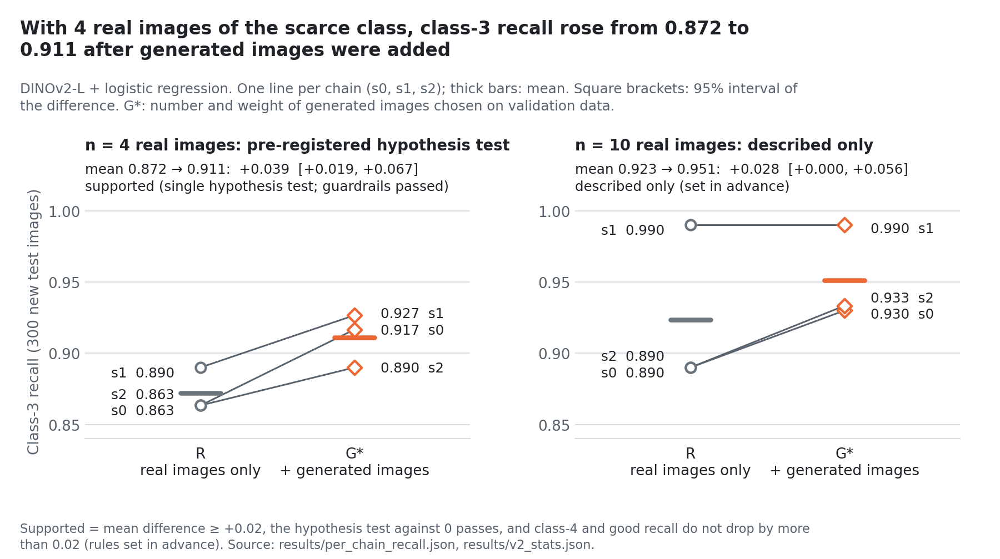
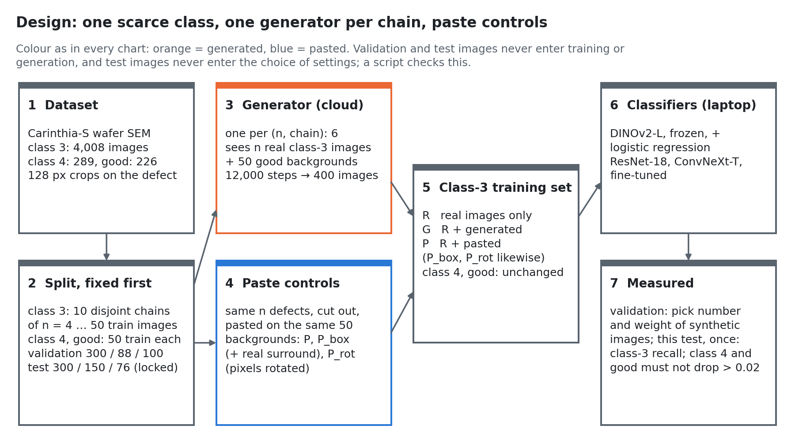
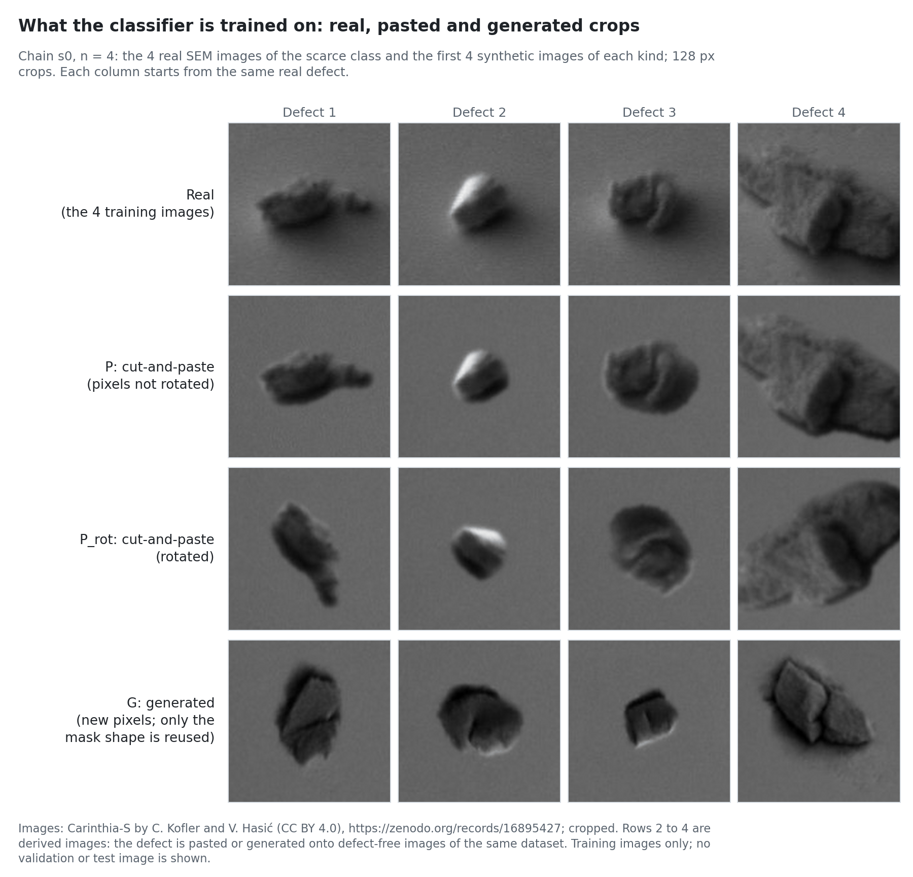
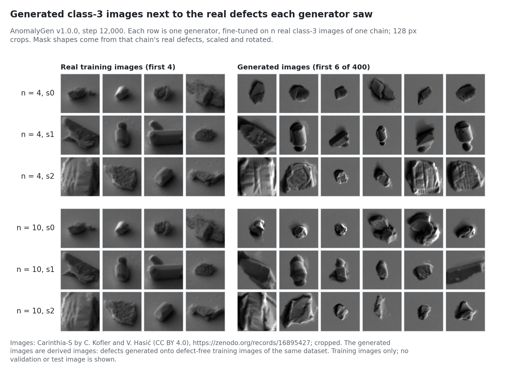
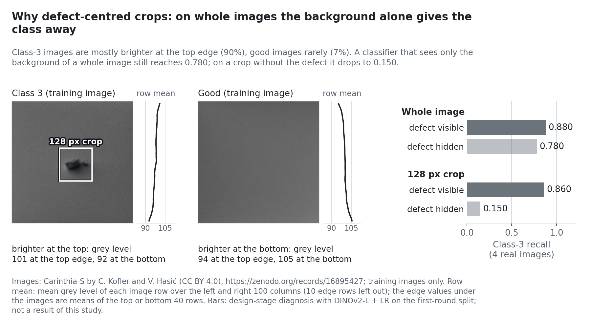
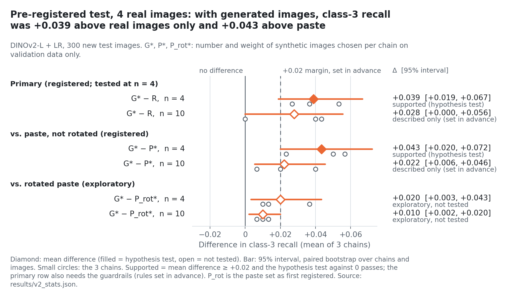

# With only 4 real images of a defect class, do generated images help the classifier?

A pre-registered experiment on Carinthia-S wafer SEM images [1] with the public NVIDIA Cosmos AnomalyGen pipeline (v1.0.0) [5].

Built on NVIDIA Cosmos.

> A personal portfolio project. It is not an NVIDIA project and has not been reviewed or endorsed by NVIDIA or by the dataset authors.

One few-shot generator per set of 4 (or 10) real images of one defect class was fine-tuned with the public AnomalyGen v1.0.0, and a pre-registered test on held-out images, with no re-runs, asked whether adding the generated images raises a classifier's recall on that class.

## In short

- **Question.** When a defect class has only 4 real images, does adding generated images help a classifier recognise it?
- **Training data.** Class 3: 4 real images plus 25 to 100 generated images (amount chosen on validation data; from 25 images on, the gain changes little); class 4: 50 real images; good: 50 real images.
- **Result.** Yes, on this dataset. Class-3 recall (the share of class-3 test images classified correctly) rose from 0.872 to 0.911 (87.2% to 91.1%). Over 900 predictions (300 test images × 3 sets of 4 real images, called chains below), class-3 errors fell from 115 to 80. The pre-registered hypothesis is supported, and the other classes held.
- **Control.** Plain cut-and-paste of the same 4 defects did not help (119 errors). Rotated cut-and-paste reached 98 errors, 2.0 points behind generated images; that comparison is exploratory.
- **Other classifiers (secondary analysis).** Two fine-tuned CNNs gained more but stayed below DINOv2 with real images only, and ConvNeXt-T failed the guardrail.
- **Limits.** One dataset, one defect class, 3 chains; classification of known defect types, not detection. With 10 real images the gain was smaller (+0.028) and was set in advance to be described only.

## Conclusions

1. **The pre-registered primary hypothesis is supported at n = 4.** In automatic defect classification (ADC) on Carinthia-S, with only 4 real images of class 3, after images generated by the public AnomalyGen v1.0.0 were added, the class-3 recall of a frozen DINOv2-L + logistic regression on 300 new test images rose from 0.872 to 0.911. The gain is +0.039 (95% confidence interval [+0.019, +0.067], 3 chains); summed over the 3 chains (3 × 300 test predictions), the class-3 errors fell from 115 to 80. Class-4 and good recall did not drop beyond the limit. n = 10 was set in advance to be described only: 0.923 → 0.951 (+0.028).
2. **CNNs with generated images still score below DINOv2 with real images only.** With the same 4 real images, ResNet-18 went from 0.683 to 0.809 and ConvNeXt-T from 0.693 to 0.830, both below the 0.872 of DINOv2 on real images only; ConvNeXt-T's class-4 recall fell by 0.041, beyond the guardrail. The comparison of three classifiers is a secondary analysis added after the validation results had been seen.
3. **Generated images beat cut-and-paste, but against rotated paste the difference is only at the edge of the 0.02 margin.** Generated images scored +0.043 above paste without pixel rotation (pre-registered, supported; the chain-level t interval still includes 0). Against rotated paste the difference is +0.020 (exploratory), exactly the pre-set margin of 0.02, so it is reported as an exploratory observation only.

<picture>
  <source media="(prefers-color-scheme: dark)" srcset="figures/fig01_primary_dark.png">
  
</picture>

Figure 1. The pre-registered primary result in absolute numbers. Each line is one chain (s0, s1, s2), from real images only (R) to real plus generated images (G\*); the thick bars are the means of the 3 chains. Left, n = 4: the pre-registered hypothesis test. Right, n = 10: described only, as set in advance; chain s1 already reaches 0.990 with real images alone.

**Terms**

| Term | Meaning |
|---|---|
| Class 3 | A real defect class with many images in the dataset (no official name; it looks like particles). "Only 4 images" is simulated scarcity |
| n | Number of real class-3 images given to the classifier and to the generator (mainly n = 4; also n = 10) |
| g | Number of synthetic images added to the class-3 training set (10 to 400) |
| LR | Logistic regression ("DINOv2-L + LR" = frozen DINOv2-L features with logistic regression on top; scikit-learn [11]) |
| Margin, limit | Margin: the pre-set +0.02 that a difference in class-3 recall must reach. Limit: the −0.02 of the guardrail |
| Chain (s0, s1, s2) | A set of real class-3 training images that does not overlap the other chains. Three chains repeat the experiment with three different sets of real images, each with its own fine-tuned generator; class-4, good and test images are shared |
| R, G, P, P_box, P_rot | Five ways to build the class-3 training set: real images only, plus generated images, or plus one of three kinds of pasted images (see "Training sets") |
| G, G\* | G adds a fixed 200 images at weight real : synthetic = 1 : 1. G\* uses the number and weight chosen per chain on validation data. P\*, P_rot\* likewise |
| Recall | Share of the images of a class that are assigned to that class |
| Guardrail | Class-4 and good recall (mean over chains) must not drop by more than 0.02; otherwise the hypothesis is not supported |
| H1, H2, S1 | Primary hypothesis (G\* − R), hypothesis against paste (G\* − P\*), and G − R for the three classifiers in the secondary analysis |
| New test images | The 300 class-3 test images split off in round 2 (used once before, for an internal evaluation; see disclosure 12 in [DETAILS.md](DETAILS.md)) |

**Results at a glance** (Δ is a difference in class-3 recall. Square brackets: for H1, H2, n = 10 and the exploratory row, 95% bootstrap confidence intervals; for the secondary analysis, bootstrap intervals over 3 chains, which under-cover)

| Analysis | Comparison | Δ | Guardrail (class 4 / good) | Verdict |
|---|---|---|---|---|
| Primary hypothesis H1 (pre-registered) | DINOv2, n = 4, G\* − R | +0.039 [+0.019, +0.067] | −0.002 / 0.000, pass | **supported** |
| H2 (pre-registered) | DINOv2, n = 4, G\* − P\* | +0.043 [+0.020, +0.072] | as H1, pass | **supported** |
| Exploratory | DINOv2, n = 4, G\* − P_rot\* | +0.020 [+0.003, +0.043] | not judged | described only |
| n = 10 (described only, set in advance) | DINOv2, G\* − R | +0.028 [+0.000, +0.056] | 0.000 / 0.000 | described only |
| Secondary S1 | DINOv2, n = 4, G − R | +0.040 [+0.017, +0.073] | −0.002 / 0.000, pass | supported (3 chains agree in direction) |
| Secondary S1 | ResNet-18, n = 4, G − R | +0.127 [+0.071, +0.189] | −0.018 / 0.000, pass (1 chain beyond the limit on its own) | supported (3 chains agree in direction) |
| Secondary S1 | ConvNeXt-T, n = 4, G − R | +0.136 [+0.061, +0.212] | −0.041 / 0.000, **fail** | **not supported (guardrail failed)** |

The secondary analysis was added after the validation results had been seen. The chain-level t interval (2 degrees of freedom) excludes 0 for H1 ([+0.005, +0.072]); for H2 and all three S1 rows it still includes 0. Differences are computed before rounding, so they can differ from the rounded recalls by 0.001.

Scope: observed only on Carinthia-S, class 3, defect-centred 128 px crops and 3 chains. This is a defect **classification** result, not a defect detection rate, and it says nothing about other datasets.

Power is low: the plan estimated that n = 4 needs at least 4 chains to reach a conclusion near 0.02 and 3 were run, so a true effect of only about 0.02 would most likely not be shown. Validation numbers are optimistic and are not results (disclosure 3 and the further points in [DETAILS.md](DETAILS.md)).

Secondary and exploratory analyses, the cost of errors, the full list of disclosures, compute and hardware, and the pre-registration evidence are in **[DETAILS.md](DETAILS.md)**.

## Question and context

Inspection in semiconductor manufacturing runs in roughly three steps: an inspection tool finds where the defects are, a review SEM images them, and automatic defect classification (ADC) assigns each defect to a class [27]. When a new defect class appears there are often only a few images of it, and a classifier learns it poorly.

This project asks about the ADC step: **when a defect class has only n real images and a few-shot generator supplies synthetic images, does the classifier's recall on that class go up? If it does, is that the generator's contribution, or would cutting the same few defects out and pasting them onto other backgrounds do the same?**

Few-shot generation of defect and anomaly images has been studied with GANs [19] and with diffusion models [2]; AnomalyGen takes the diffusion route and is built on NVIDIA Cosmos [4, 6]. Cutting an object or patch out and pasting it elsewhere is a common, simple way to make extra training images, for instance segmentation [17] and for anomaly detection [18], which is why it serves as the control here.

Not addressed and not claimed:

- Defect detection (is there a defect at all). Defect images in Carinthia-S carry a bright framing square left by the review step and good images do not, so "defect versus good" is easy on this data and cannot be used to assess detection.
- Yield.
- Any dataset other than Carinthia-S.

## Design

<picture>
  <source media="(prefers-color-scheme: dark)" srcset="figures/fig02_design_dark.png">
  
</picture>

Figure 2. Design overview. The split is fixed first (step 2); generators and paste controls come after it (steps 3 and 4); the five training sets differ only in what is added to class 3 (step 5). In this test the validation set was used only to choose the number and weight of synthetic images (it had served other design decisions earlier; see disclosure 3 in [DETAILS.md](DETAILS.md)); this test was run once (step 7).

### Data and simulated scarcity

The dataset is Carinthia-S [1] (wafer SEM images, CC BY 4.0). Classes have numbers only, no official names; "particles" for class 3 is my own description.

Only the three classes with enough images and ground truth are used: class 3 (4,008 images), class 4 (289; 288 are used, one validation image was dropped as a duplicate photo) and good (226). The classifier has 3 classes. Scarcity is simulated on the large class 3: training gets n images, and validation and test images are held out from the remainder.

| Class | Training | Validation (only to choose settings and to apply the stop rule) | Test |
|---|---|---|---|
| Class 3 (simulated scarcity) | n images, n = 4, 6, 8, 10, 15, 25, 50 | 300 | new test set, 300 |
| Class 4 (always plentiful) | 50 | 88 | 150 |
| Good | 50 (also the only backgrounds for generation) | 100 | 76 |

- **Chains.** The class-3 training images form 10 mutually disjoint chains of 50 images, nested within each chain (4 ⊂ 6 ⊂ 8 ⊂ 10 ⊂ …). The real-only curve uses 10 chains; generators exist for the 3 chains s0 to s2 (3 each at n = 4 and n = 10). Four chains were planned for n = 4 and three were run; see disclosure 2 in [DETAILS.md](DETAILS.md).
- **The split was fixed before any round-2 generated image existed**, and the test list is locked by sha256. Validation and test images never enter training or generation, and test images never enter the choice of settings; a script checks this before every training run and every upload.
- Metrics are per-class recall and their mean (balanced accuracy); overall accuracy is not reported.

### Training sets

| Set | Class-3 training data |
|---|---|
| R | n real images only |
| G | R + images generated by AnomalyGen |
| P | R + cut-and-paste: the same n real defects are cut out with their annotation masks and pasted onto the same 50 good backgrounds; scaled and shifted, **pixels not rotated** |
| P_rot | As P, but the pixels are rotated. This is the paste version first registered, later moved to an exploratory control (disclosure 6 in [DETAILS.md](DETAILS.md)) |
| P_box | As P, but cut together with 24 px of real surround outside the mask's bounding box (it carries the shading next to the defect and the bright square; real pixels only, nothing drawn) |

The paste sets separate two things: "the same defects appear on more backgrounds" and "images produced by a generator". G, P, P_rot and P_box use the same number of images, cycle through the backgrounds in the same order, and have the same distributions of scale and position. The starred G\*, P\*, P_rot\* are the versions whose number of images (10 to 400) and weight (1 : 1 or 2 : 1) were chosen per chain on validation data; unstarred sets use the fixed setting (200 images, 1 : 1).

<picture>
  <source media="(prefers-color-scheme: dark)" srcset="figures/fig03_arms_dark.png">
  
</picture>

Figure 3. Chain s0, n = 4: the 4 real training images (top row) and the first 4 pasted, rotated-paste and generated images made from them. Each column starts from the same real defect; the generated row reuses only that defect's mask shape (scaled and rotated); its pixels are newly generated. Images: Carinthia-S (CC BY 4.0), cropped; rows 2 to 4 are derived images in which the defect is pasted or generated onto good images of the same dataset. Training images only; no validation or test image is shown.

### Generators

- Code: the public [NVIDIA/cdf-anomalygen](https://github.com/NVIDIA/cdf-anomalygen/tree/v1.0.0) **v1.0.0** (commit `fcad44cd`) [5].
- One generator is fine-tuned per (n, chain), 6 in total. Each sees only the n class-3 images of its chain and the 50 good training images; the 10 images at n = 10 include the 4 of the same chain at n = 4.
- The model is Cosmos-Predict2-2B-Text2Image [4, 6], fine-tuned few-shot through the AnomalyGen pipeline, which follows AnomalyDiffusion [2] (backbone frozen, only the added components trained), for a fixed 12,000 steps.
- Each generator produces 400 images: the 50 backgrounds are used in turn, and masks are the annotation masks of the n images, scaled (0.6 to 1.2), rotated and shifted, placed within ±60 px of the image centre.
- Only class 3 is generated; class 4 is real images throughout.

<picture>
  <source media="(prefers-color-scheme: dark)" srcset="figures/fig04_generated_dark.png">
  
</picture>

Figure 4. One row per generator (step 12,000): on the left the first 4 real training images of that chain, on the right the generator's first 6 images, 128 px crops. In the n = 4 rows the left side shows all 4 class-3 images the generator saw; the n = 10 rows show the first 4 of its 10 images. The right side shows derived images: defects generated onto good training images of Carinthia-S (CC BY 4.0). No validation or test image is shown.

### Why 128 px crops

The first-round design used whole images. I measured the background brightness along the four edges of the images of each class (at the design stage, on first-round images) and found that **the direction of the background shading alone separates the classes**: 90% of class-3 images are brighter at the top edge than at the bottom, against 7% of good images. This has nothing to do with the defect; it is a cue left by image acquisition.

<picture>
  <source media="(prefers-color-scheme: dark)" srcset="figures/fig05_why_crop_dark.png">
  
</picture>

Figure 5. Left: a class-3 training image (white frame: the 128 px crop) and a good training image; the curve beside each is the mean grey level of the background in every row. The shading runs in opposite directions. Right: the design-stage diagnosis; in each pair the upper, solid bar is the input with the defect visible, the lower, faded bar the input without it. Images: Carinthia-S (CC BY 4.0), training images only.

The diagnosis used the same classifier (DINOv2-L + logistic regression, 4 real class-3 images, no generated images) on the first-round split:

| Input | Class-3 recall |
|---|---|
| Whole image | 0.880 |
| Background only (central 224 × 224 set to the mean; defect not visible) | 0.780 |
| 128 × 128 crop centred on the defect | 0.860 |
| Background patch of the same size without a defect | 0.150 |

(This is a design-stage diagnosis, not a result of this study.)

A generated defect is always drawn on a good background, so its background carries the shading of good images, the opposite of real class 3. On whole images, generated images would fight this cue, and one could not see whether they help in themselves. Round 2 therefore defines the task on 128 × 128 crops centred on the defect: scores on real images barely change and the background cue is much weaker. This also matches the real ADC input: the position comes from the inspection tool and the classifier looks at the surroundings of the defect.

### Classifiers

| Classifier | Method |
|---|---|
| DINOv2-L + logistic regression (primary) | DINOv2-L [3] features are not trained; logistic regression [11] on top; deterministic, no seeds |
| ResNet-18, ConvNeXt-T (secondary) | Fine-tuned with AdamW [12] from pre-trained timm [9] weights (ResNet-18 [7], ConvNeXt-T [8]; see "Licences and credits") for 3,000 steps; 6 seeds for n = 4 with 200 images, 3 seeds for g = 50 and for n = 10 |

The three classes have equal total weight; within class 3, real and synthetic images share the weight in the chosen ratio.

### Pre-registration and this test

Pre-registration means fixing the hypotheses, the analysis and the decision rules before the outcome is seen [26].

The round-2 design was frozen on 2026-11-08; the plan for the test stage (which models to train, how to judge, which sentence to write for each outcome) was fixed on 2026-11-10; the plan for this test was fixed on 2026-11-12. "This test" is the single test run with the public AnomalyGen v1.0.0 reported here. Before this test started, the plan, all code and the frozen settings were pushed to a private repository to obtain a server-side time stamp (see "Pre-registration evidence" in [DETAILS.md](DETAILS.md)).

- **Intervals.** Paired bootstrap, 2,000 resamples of chains and test images together, 95% percentile interval [14].
- **Report sentences.** The sentence for each outcome was written in advance: pick the one that matches the result, fill in the numbers, do not change the strength of the wording. The plan and these sentences are in Traditional Chinese; the sentences in this report are translations that keep that strength.
- **This test was run once** (the second use of the same test set; see the next point): started 2026-11-13 22:36:04, finished 2026-11-14 00:24:10 (Taiwan time). It stopped once (a KeyError in a file lookup, before any CNN result had been copied or any CNN trained, any statistic computed or any test number shown); a code fix was recorded (one lookup line, plus the resume check that admits exactly this change), and the run was resumed, not rerun; see disclosure 11 in [DETAILS.md](DETAILS.md). After the run, the test set is not used to adjust any setting.
- **The test set had been used once before.** The same test set was used earlier for one internal evaluation; no setting was changed afterwards, and the generation, downstream and statistical methods all follow the previously frozen version.

**Hypotheses and tests**

| Code | Comparison | Hypothesis test |
|---|---|---|
| H1 (primary) | DINOv2, n = 4, G\* − R ≥ 0.02, and the guardrail is passed | Single test, α = 0.05, no multiple-comparison correction |
| H2 | DINOv2, n = 4, G\* − P\* ≥ 0.02 | One test on its own |
| S1 (secondary) | n = 4, 200 images, 1 : 1; G − R for the three classifiers | Holm correction [15], 3 tests |
| S2, S3 (secondary) | As above, G − P and G − P_box | Holm correction, 6 tests; if supported, written only as "the 3 chains agree in direction"; interpreted only when S1 is supported for the same classifier |
| n = 10 | G\* − R, G\* − P\*, G − R for the CNNs, change in class-4 and good recall | Values and intervals only, no verdict |
| Exploratory | G\* − P_rot\*, g = 50, whole images, old test set | Described only |

**Verdict rules** ("95% interval" means the bootstrap interval over 3 chains for the secondary analysis)

| Verdict | Condition |
|---|---|
| Supported | Δ ≥ 0.02, the hypothesis test passes, and the guardrail is passed; the secondary analysis also requires Δ > 0 in all 3 chains |
| Significantly worse | Upper end of the 95% interval < 0 |
| Below the margin | Upper end of the 95% interval < 0.02 (and not significantly worse) |
| Inconclusive | Anything else (interval includes 0, difference below 0.02, correction not passed, or chains differ in sign) |
| Guardrail failed | Class-4 or good recall (mean over chains) drops by more than 0.02: not supported, whatever the class-3 result. Any single chain beyond the limit must be reported |

**What this test actually computed**

| Item | Count | What was done |
|---|---|---|
| DINOv2-L + logistic regression models | 390 | All refitted. 312 do not involve the generator; their predictions are bit-for-bit identical to the earlier output. 78 belong to G |
| CNN runs (R, P, P_box) | 198 | Do not involve the generator; the earlier test output was reused, every file checked by sha256 |
| CNN trainings (G) | 72 | Retrained in this test (36 each for ResNet-18 and ConvNeXt-T) |

## Primary results

<picture>
  <source media="(prefers-color-scheme: dark)" srcset="figures/fig06_forest_dark.png">
  
</picture>

Figure 6. Differences in class-3 recall of DINOv2-L + logistic regression with 95% intervals. Solid line: 0; dashed line: the pre-set margin of 0.02. Filled diamonds are comparisons with a hypothesis test, open diamonds are described only or exploratory; small circles are the differences of the 3 chains. "Supported" requires a mean difference ≥ 0.02 and a passed hypothesis test against 0 (and, for the primary hypothesis, the guardrail); it does not require the whole interval to lie above 0.02.

The results below use the sentences written in advance.

**H1, n = 4: supported.** With only 4 real images of class 3, after images generated by the public AnomalyGen v1.0.0 were added (number and weight chosen on validation data only), the class-3 recall of a frozen DINOv2-L + logistic regression on 300 new test images rose from 0.872 to 0.911 (+0.039, 95% confidence interval [+0.019, +0.067], the single pre-registered hypothesis test passed, 3 chains); class-4 recall changed by −0.002 and good recall by 0.000 (limit −0.02). This is the pre-registered primary hypothesis, and it is supported; the scope is limited to Carinthia-S, defect-centred crops and 3 chains. (Per chain +0.053 / +0.037 / +0.027; chain-level t interval [+0.005, +0.072].)

**H2, n = 4: supported.** Generated images scored 0.043 higher than "the same 4 defects cut out and pasted without rotating the pixels" ([+0.020, +0.072]; per chain +0.057 / +0.050 / +0.023; chain-level t interval [−0.000, +0.087], whose lower end is −0.0005, so it still includes 0). Against the rotated paste as first registered (P_rot\*, exploratory) the difference is +0.020 ([+0.003, +0.043]; per chain +0.010 / +0.037 / +0.013; chain-level t interval [−0.016, +0.056]). This difference just reaches the pre-set margin of 0.02 and its interval excludes 0; even so, by the pre-set rule it can only be written as an exploratory observation: on this data generated images did slightly better than rotated paste, but that is not enough to say that this difference comes from new appearances produced by the generator.

**n = 10 (described only).** G\* − R is +0.028 ([+0.000, +0.056]; 0.923 → 0.951; per chain +0.040 / +0.000 / +0.043), G\* − P\* is +0.022 ([+0.006, +0.046]) and G\* − P_rot\* is +0.010 ([+0.002, +0.020]). Class-4 and good recall did not change. As set in advance, no verdict is given for n = 10.

**Values per chain (DINOv2, class-3 recall on the 300 new test images; settings chosen per chain on validation data)**

| n | Chain | Setting of G\* (images; real : synthetic) | R | G\* | G\* − R | P\* | P_rot\* |
|---|---|---|---|---|---|---|---|
| 4 | s0 | 25 images; 2 : 1 | 0.863 | 0.917 | +0.053 | 0.860 | 0.907 |
| 4 | s1 | 100 images; 1 : 1 | 0.890 | 0.927 | +0.037 | 0.877 | 0.890 |
| 4 | s2 | 100 images; 1 : 1 | 0.863 | 0.890 | +0.027 | 0.867 | 0.877 |
| 4 | mean | | 0.872 | 0.911 | +0.039 | 0.868 | 0.891 |
| 10 | s0 | 50 images; 2 : 1 | 0.890 | 0.930 | +0.040 | 0.890 | 0.920 |
| 10 | s1 | 200 images; 2 : 1 | 0.990 | 0.990 | 0.000 | 0.983 | 0.983 |
| 10 | s2 | 100 images; 1 : 1 | 0.890 | 0.933 | +0.043 | 0.913 | 0.920 |
| 10 | mean | | 0.923 | 0.951 | +0.028 | 0.929 | 0.941 |

The values per chain are in [`results/per_chain_recall.json`](results/per_chain_recall.json).

## More in DETAILS.md

[DETAILS.md](DETAILS.md) continues with:

- **Secondary analysis**: three classifiers at n = 4 (figures 7 and 8), generated images against paste.
- **Exploratory observations**: how many real images the generated images are worth (figure 9), gain by number of synthetic images (figure 10).
- **Cost of errors**: confusion matrices (figure 11).
- **How the design came about**: timeline (figure 12).
- **Disclosures**: 12 points, including the one stop during the test run and the second use of the test set.
- **Compute and hardware**, and the **pre-registration evidence**.

## Files and reproduction

| Path | Contents |
|---|---|
| `results/v2_stats.json` | Statistics of this test. Every test-set statistic on these pages comes from this file; values per chain come from `per_chain_recall.json`. Verdict labels were translated to English; the numbers are those of the original output. "v2" in the file names and in the key `H-v2b` refers to the round-2 design, not to a software version. "9A.x" refers to sections of the pre-registered plan (kept in the private time-stamp repository). Codes: H1 = primary hypothesis (JSON key `primary`); H2 = G\* − P\* (JSON key `H-v2b`); S1, S2, S3 = G − R, G − P, G − P_box in the secondary analysis (JSON keys `H-A1`, `H-A2`, `H-A3`) |
| `results/v2_stats.md` | Table view of the JSON file, written by `scripts/stats_table.py` |
| `results/per_chain_recall.json` | Recall per chain (aggregated from per-image predictions): class-3 and class-4 recall for figures 7 and 8, and the per-chain values and chosen settings of the primary analysis for figure 1 |
| `scripts/make_figures.py` | Draws figures 1, 2 and 6 to 12 from the files above |
| `scripts/stats_table.py` | Writes `results/v2_stats.md` from `results/v2_stats.json` |
| `requirements.txt` | Package versions the scripts were run with |
| `figures/` | Twelve figures, numbered in order of appearance, each in a light and a dark version |
| `LICENSE`, `LICENSE-docs.md` | Licences: code MIT; text, figures and results CC BY 4.0 |
| `CITATION.cff` | How to cite this repository |

```
python scripts/make_figures.py
python scripts/stats_table.py
```

Requires Python 3.10 or later with numpy [21], matplotlib [22] and Pillow (`pip install -r requirements.txt`). Figures 3, 4 and 5 are image panels that need the dataset and the generated images, which this repository does not contain, so they are not redrawn by default; with those files at hand they are drawn with `--private-root DIR --generated-dir SUB --test-dir SUB` (see `python scripts/make_figures.py --help`).

Not in this repository: dataset images and generated images (apart from the training images, pasted images and generated images shown in figures 3, 4 and 5; figure 5 shows two whole training images, the others are crops), validation and test images, model weights, per-image predictions.

## Licences and credits

- **Dataset [1].** Carinthia-S by Corinna Kofler (KAI GmbH) and Vahidin Hasić (University of Sarajevo), Zenodo, 2025, https://doi.org/10.5281/zenodo.16895427, licensed [CC BY 4.0](https://creativecommons.org/licenses/by/4.0/); an enhanced version of the original Carinthia dataset (Kofler et al., version 1.0.3, Zenodo, 2024, https://doi.org/10.5281/zenodo.10696644), which this project did not use directly. Changes made here: 4 px trimmed on the right, masks binarised, 128 × 128 crops centred on the defect; good images used as backgrounds for pasting and generation. The images in figures 3, 4 and 5 are cropped from or derived from this dataset, are shared under CC BY 4.0, and credit the source.
- **Generator code.** NVIDIA/cdf-anomalygen v1.0.0 (commit `fcad44cd`) [5], titled "PAIDF AnomalyGen" in that version's README and "Cosmos AnomalyGen" in its NOTICE; its LICENSE, NOTICE and the SPDX tags of its source files are Apache-2.0. The README of that version ends with one sentence naming the NVIDIA Software and Model Evaluation License, which does not agree with the LICENSE file; this project uses the code under the LICENSE file. This is not legal advice.
- **Generator model.** Cosmos-Predict2-2B-Text2Image (NVIDIA Open Model License, https://www.nvidia.com/en-us/agreements/enterprise-software/nvidia-open-model-license/), fine-tuned through the AnomalyGen pipeline. The configuration used also loads the T5-large text encoder [25] (Apache-2.0) and initialises its mask encoder from NVIDIA NV-DINOv2 (NVIDIA TAO; NVIDIA Open Model License). Built on NVIDIA Cosmos [4, 6].
- **Method.** The AnomalyGen pipeline follows AnomalyDiffusion (Hu et al., AAAI 2024) [2].
- **Feature model.** DINOv2 ViT-L/14 [3], checkpoint facebook/dinov2-large (Apache-2.0), loaded with Hugging Face Transformers [20]. ResNet-18 [7] and ConvNeXt-T [8] start from timm [9] weights (Apache-2.0): resnet18.a1_in1k (ImageNet-1k [10], training recipe of [24]) and convnext_tiny.in12k_ft_in1k (pre-trained on ImageNet-12k, a subset of the full ImageNet [10], then fine-tuned on ImageNet-1k).
- **Software.** PyTorch 2.10 [13], timm 1.0.27 [9], Transformers 4.57 [20], scikit-learn 1.7 [11] (logistic regression), SciPy 1.15 [16] (t intervals), NumPy 2.2 [21], Matplotlib 3.10 [22] and Pillow 12.2 (figures); the CNNs are fine-tuned with AdamW [12]. Bootstrap intervals and the Holm procedure are implemented in this project's own code following [14, 15].
- **Compute.** Generators were fine-tuned and images generated on an NVIDIA A100 on NVIDIA Brev; classifiers were trained and evaluated on a laptop RTX 3080 Ti.
- This is a personal project, not affiliated with or endorsed by NVIDIA or the dataset authors.
- **This repository.** Code (`scripts/`) under MIT (see `LICENSE`); text, figures and result files under CC BY 4.0 (see `LICENSE-docs.md`). Figures 3, 4 and 5 also require credit to Carinthia-S.

## References

1. Kofler, C., Hasić, V. (2025). *Carinthia-S dataset* [Data set]. Zenodo. https://doi.org/10.5281/zenodo.16895427 (CC BY 4.0). Derived from: Kofler, C. et al. (2024). *Carinthia dataset* (version 1.0.3) [Data set]. Zenodo. https://doi.org/10.5281/zenodo.10696644.
2. Hu, T. et al. (2024). *AnomalyDiffusion: Few-Shot Anomaly Image Generation with Diffusion Model.* AAAI 2024. arXiv:2312.05767, https://arxiv.org/abs/2312.05767
3. Oquab, M. et al. (2024). *DINOv2: Learning Robust Visual Features without Supervision.* Transactions on Machine Learning Research. arXiv:2304.07193, https://arxiv.org/abs/2304.07193
4. NVIDIA (2025). *Cosmos-Predict2* [Software and models]. https://github.com/nvidia-cosmos/cosmos-predict2 (code Apache-2.0; repository now archived; accessed 2026-11-16). Model used: Cosmos-Predict2-2B-Text2Image, https://huggingface.co/nvidia/Cosmos-Predict2-2B-Text2Image (NVIDIA Open Model License).
5. NVIDIA (2026). *Cosmos AnomalyGen* (cdf-anomalygen), version 1.0.0, commit fcad44cd [Software]. https://github.com/NVIDIA/cdf-anomalygen/tree/v1.0.0 (Apache-2.0; accessed 2026-11-16).
6. NVIDIA et al. (2025). *Cosmos World Foundation Model Platform for Physical AI.* arXiv:2501.03575, https://arxiv.org/abs/2501.03575
7. He, K., Zhang, X., Ren, S., Sun, J. (2016). *Deep Residual Learning for Image Recognition.* CVPR 2016. arXiv:1512.03385, https://arxiv.org/abs/1512.03385
8. Liu, Z. et al. (2022). *A ConvNet for the 2020s.* CVPR 2022. arXiv:2201.03545, https://arxiv.org/abs/2201.03545
9. Wightman, R. (2019). *PyTorch Image Models (timm)* [Software]; version 1.0.27 used. https://github.com/huggingface/pytorch-image-models, https://doi.org/10.5281/zenodo.4414861
10. Deng, J. et al. (2009). *ImageNet: A Large-Scale Hierarchical Image Database.* CVPR 2009. https://doi.org/10.1109/CVPR.2009.5206848
11. Pedregosa, F. et al. (2011). *Scikit-learn: Machine Learning in Python.* Journal of Machine Learning Research 12, 2825-2830. https://jmlr.org/papers/v12/pedregosa11a.html
12. Loshchilov, I., Hutter, F. (2019). *Decoupled Weight Decay Regularization.* ICLR 2019. arXiv:1711.05101, https://arxiv.org/abs/1711.05101
13. Paszke, A. et al. (2019). *PyTorch: An Imperative Style, High-Performance Deep Learning Library.* NeurIPS 2019. arXiv:1912.01703, https://arxiv.org/abs/1912.01703
14. Efron, B., Tibshirani, R. J. (1993). *An Introduction to the Bootstrap.* Chapman & Hall.
15. Holm, S. (1979). *A Simple Sequentially Rejective Multiple Test Procedure.* Scandinavian Journal of Statistics 6(2), 65-70.
16. Virtanen, P. et al. (2020). *SciPy 1.0: Fundamental Algorithms for Scientific Computing in Python.* Nature Methods 17, 261-272. https://doi.org/10.1038/s41592-019-0686-2, arXiv:1907.10121
17. Ghiasi, G. et al. (2021). *Simple Copy-Paste is a Strong Data Augmentation Method for Instance Segmentation.* CVPR 2021. arXiv:2012.07177, https://arxiv.org/abs/2012.07177
18. Li, C.-L., Sohn, K., Yoon, J., Pfister, T. (2021). *CutPaste: Self-Supervised Learning for Anomaly Detection and Localization.* CVPR 2021. arXiv:2104.04015, https://arxiv.org/abs/2104.04015
19. Duan, Y., Hong, Y., Niu, L., Zhang, L. (2023). *Few-Shot Defect Image Generation via Defect-Aware Feature Manipulation.* AAAI 2023. arXiv:2303.02389, https://arxiv.org/abs/2303.02389
20. Wolf, T. et al. (2020). *Transformers: State-of-the-Art Natural Language Processing.* EMNLP 2020: System Demonstrations, 38-45. https://doi.org/10.18653/v1/2020.emnlp-demos.6
21. Harris, C. R. et al. (2020). *Array programming with NumPy.* Nature 585, 357-362. https://doi.org/10.1038/s41586-020-2649-2
22. Hunter, J. D. (2007). *Matplotlib: A 2D Graphics Environment.* Computing in Science & Engineering 9(3), 90-95. https://doi.org/10.1109/MCSE.2007.55
23. Ravi, N. et al. (2024). *SAM 2: Segment Anything in Images and Videos.* arXiv:2408.00714, https://arxiv.org/abs/2408.00714
24. Wightman, R., Touvron, H., Jégou, H. (2021). *ResNet strikes back: An improved training procedure in timm.* arXiv:2110.00476, https://arxiv.org/abs/2110.00476
25. Raffel, C. et al. (2020). *Exploring the Limits of Transfer Learning with a Unified Text-to-Text Transformer.* Journal of Machine Learning Research 21. arXiv:1910.10683, https://arxiv.org/abs/1910.10683
26. Nosek, B. A., Ebersole, C. R., DeHaven, A. C., Mellor, D. T. (2018). *The preregistration revolution.* PNAS 115(11), 2600-2606. https://doi.org/10.1073/pnas.1708274114
27. Chou, P. B., Rao, A. R., Sturzenbecker, M. C., Wu, F. Y., Brecher, V. H. (1997). *Automatic defect classification for semiconductor manufacturing.* Machine Vision and Applications 9(4), 201-214. https://doi.org/10.1007/s001380050041
